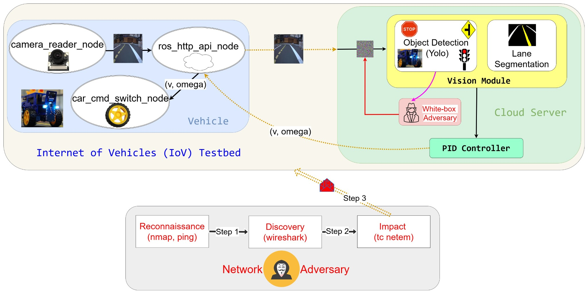
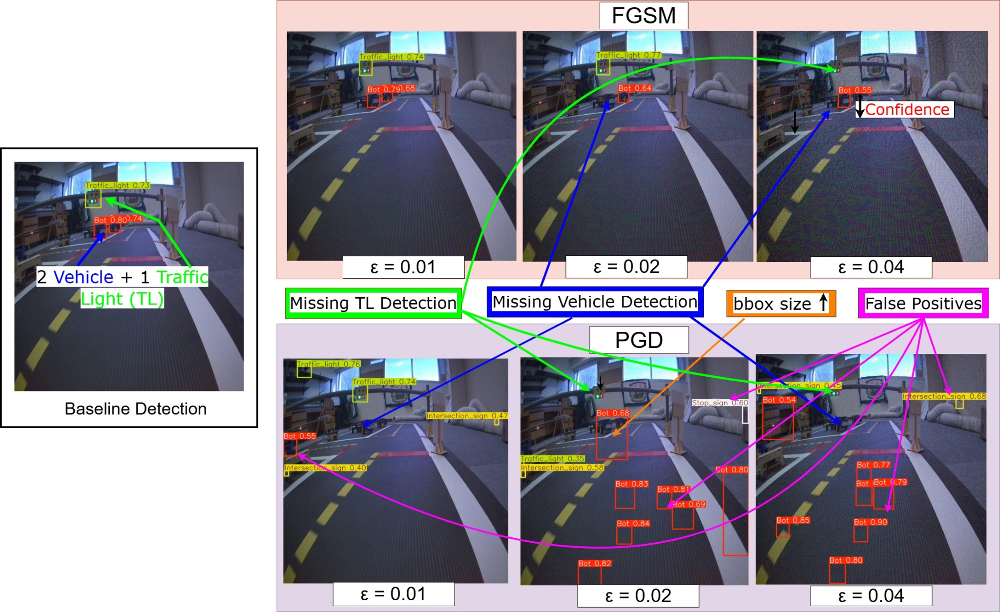
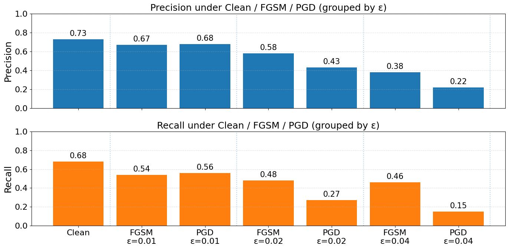
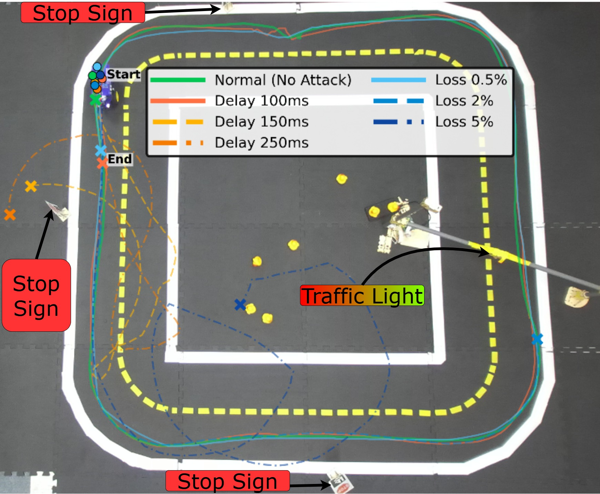

# Adversarial Robustness Analysis of Cloud-Assisted Autonomous Driving Systems

This repository provides the source code and experimental material accompanying the accepted IEEE conference paper:

> **Adversarial Robustness Analysis of Cloud-Assisted Autonomous Driving Systems**  
> **Maher Al Islam and Amr S. El-Wakeel**  
> *2026 International Conference on Smart Mobility (SM)*, IEEE, 2026.  
> **DOI:** [10.1109/SM69703.2026.11614113](https://doi.org/10.1109/SM69703.2026.11614113)

## Overview

Cloud-assisted autonomous driving moves computationally intensive perception and control from the vehicle to a remote server. Although this architecture supports powerful perception models, it also exposes the driving loop to **adversarial manipulation of camera images** and **disruptions of vehicle–cloud communication**.

This paper presents a hardware-in-the-loop **Internet of Vehicles (IoV) testbed** built using Duckietown. A Duckiebot transmits camera frames to a GPU workstation over TCP. The workstation performs **YOLOv8n object detection**, **U-Net lane segmentation**, and **PID-based motion control**, then returns the linear and angular velocity commands to the vehicle.

The study investigates two threat categories:

1. **Adversarial AI:** White-box Fast Gradient Sign Method (FGSM) and Projected Gradient Descent (PGD) attacks targeting YOLOv8 object detection.
2. **Network adversary:** Controlled delay and packet loss in the vehicle–cloud communication loop using Linux `tc netem`, with the attack workflow organized around the MITRE ATT&CK framework.

The experiments assess their effects on **detection precision and recall, vehicle trajectory stability, and traffic-rule compliance**.

## System Architecture



*Figure 1. Architecture of the cloud-assisted autonomous driving testbed.*

The framework has three components:

- **Vehicle module:** The Duckiebot captures camera images through ROS, sends them to the GPU server over TCP, and executes the returned velocity commands.
- **Cloud module:** The workstation performs object detection, lane segmentation, and PID-based control using the received frames.
- **Adversary module:** FGSM/PGD perturb the input frames prior to detection; network impairment scenarios introduce delay and packet loss in the communication channel.

The Duckiebot-side ROS client is deployed using **`dts devel` in Docker**. The GPU server runs on the workstation.

## Repository Contents

```text
Adversarial-Robustness-Analysis-of-Cloud-Assisted-Autonomous-Driving-Systems/
├── README.md
├── Dockerfile
├── launchers/default.sh
├── packages/my_package/
│   └── src/vehicle_client.py        # Duckiebot ROS/TCP client
├── gpu_server.py                     # Cloud TCP server
├── perception_control.py             # YOLOv8, U-Net, and driving control
├── segmentation/unet_model.py        # U-Net implementation
├── adversarial_attacks.py            # White-box FGSM and PGD
├── configure_attacks.py              # Runtime attack configuration
├── evaluate_adversarial_detection.py # Offline adversarial evaluation
├── plot_adversarial_metrics.py       # Detection metrics visualization
├── run_network_impairment.sh         # Delay and packet-loss scenarios
├── weight/                           # Perception model checkpoints
├── results/figure4_published_values.csv
└── figures/                          # Figures from the accepted paper
```

## Experimental Setup

| Parameter | Setting in the paper |
| --- | --- |
| Vehicle platform | Duckiebot with Jetson board |
| Cloud workstation | Ubuntu 22.04; NVIDIA RTX A2000 (12 GB); 32 GB RAM |
| Object detector | YOLOv8n |
| Lane segmentation | U-Net |
| Image resolution | 640 × 640 |
| Detection dataset | 4,886 annotated Duckiebot RGB frames |
| Train/test split | 70% / 30% |
| Adversarial attacks | FGSM and PGD (white-box) |
| Perturbation budgets | ε ∈ {0.01, 0.02, 0.04} |
| PGD step size / iterations | α = 0.01 / 10 |
| Network delay scenarios | 100, 150, and 250 ms |
| Packet loss scenarios | 0.5%, 2%, and 5% |

### Running the cloud-assisted testbed

**1. GPU workstation**

```bash
git clone https://github.com/ICPS-LAB-WVU/Adversarial-Robustness-Analysis-of-Cloud-Assisted-Autonomous-Driving-Systems.git
cd Adversarial-Robustness-Analysis-of-Cloud-Assisted-Autonomous-Driving-Systems

# Install a compatible PyTorch/CUDA environment and the server dependencies.
python3 -m pip install -r requirements-server.txt

# The perception code also requires a compatible YOLOX/ByteTrack installation.
export YOLO_WEIGHTS=weight/yolo.pt
export SEG_WEIGHTS=weight/segment_model_old.pth
export GPU_SERVER_PORT=5001
export SHOW_GUI=0
python3 gpu_server.py
```

**2. Duckiebot (`dts devel` Docker deployment)**

```bash
# Run from the repository checkout using Duckietown Shell.
dts devel build -H <duckiebot-name> -f

export GPU_SERVER_IP=<gpu-workstation-ip>
export GPU_SERVER_PORT=5001
export GPU_FRAME_RATE=15

dts devel run -H <duckiebot-name> -f -- \
  -e GPU_SERVER_IP \
  -e GPU_SERVER_PORT \
  -e GPU_FRAME_RATE
```

The Duckiebot launcher runs `vehicle_client.py` inside the ROS-enabled container. The vehicle streams JPEG frames to the server, which returns velocity (`v`) and angular velocity (`omega`) commands.

## Adversarial AI Experiments

White-box FGSM and PGD perturb the visual input before YOLOv8 inference. The paper evaluates increasing perturbation budgets of **ε = 0.01, 0.02, and 0.04**.



*Figure 3. Qualitative detection results. FGSM and PGD cause missed vehicle or traffic-light detections, reduced confidence, and false-positive detections; PGD produces more severe degradation.*

To generate offline FGSM/PGD examples using a YOLO-format dataset, run:

```bash
python3 evaluate_adversarial_detection.py \
  --images dataset/images \
  --labels dataset/labels \
  --weights weight/yolo.pt \
  --out offline_attacks \
  --eps 0.01 0.02 0.04 \
  --pgd-alpha 0.01 \
  --pgd-iters 10 \
  --loss-mode full

python3 plot_adversarial_metrics.py --root . --bar-conf 0.25 --bar-iou 0.5
```

The image dataset must be placed in `dataset/` before running the evaluation. The command explicitly sets the attack parameters reported in the paper rather than relying on the scripts' default values.

### Detection performance



*Figure 4. Object-detection precision and recall under clean and adversarial conditions.*

| Condition | Precision | Recall |
| --- | ---: | ---: |
| Clean | 0.73 | 0.68 |
| FGSM, ε = 0.01 | 0.67 | 0.54 |
| PGD, ε = 0.01 | 0.68 | 0.56 |
| FGSM, ε = 0.02 | 0.58 | 0.48 |
| PGD, ε = 0.02 | 0.43 | 0.27 |
| FGSM, ε = 0.04 | 0.38 | 0.46 |
| PGD, ε = 0.04 | **0.22** | **0.15** |

At ε = 0.04, PGD reduces detection precision from **0.73 to 0.22** and recall from **0.68 to 0.15**, corresponding to approximately 70% and 78% decreases relative to the clean baseline. The paper also analyzes class-level errors through confusion matrices (Figure 5 of the paper).

## Network Adversary Experiments

The network adversary induces controlled communication delay and packet loss through **Linux `tc netem`** to examine the effect on closed-loop driving. The paper evaluates network delays of **100, 150, and 250 ms** and packet-loss rates of **0.5%, 2%, and 5%**.

For example, on an authorized, isolated experiment network:

```bash
# Set DEVICE to the network interface used by the Duckiebot–cloud connection.
DEVICE=<network-interface> ./run_network_impairment.sh delay 150 90
DEVICE=<network-interface> ./run_network_impairment.sh loss 2 90
```

The script configures the selected interface and launches the cloud server for each test. It requires permission to use `tc`, and should not be run concurrently with another server instance on the same port.



*Figure 6. Vehicle trajectories under network delay and packet-loss conditions. Increased impairment produces trajectory deviations and, at severe levels, incomplete laps or lane departures.*

### Traffic-rule compliance

The following table reproduces the paper's reported stop-sign compliance for the three intersections.

| Network condition | Stop 1 | Stop 2 | Stop 3 |
| --- | :---: | :---: | :---: |
| Normal (no attack) | ✓ | ✓ | ✓ |
| Delay 100 ms | ✓ | ✓ | ✓ |
| Delay 150 ms | ✗ | ✗ | ✗ |
| Delay 250 ms | ✗ | ✗ | ✗ |
| Loss 0.5% | ✓ | ✓ | ✗ |
| Loss 2% | ✓ | ✗ | ✗ |
| Loss 5% | ✓ | ✗ | ✗ |

The results show that network impairment can destabilize the perception–control loop and cause missed stopping events, even when the visual perception model is not directly attacked.

## Citation

If you use this repository or refer to the reported results, please cite:

```bibtex
@inproceedings{al2026adversarial,
  title={Adversarial Robustness Analysis of Cloud-Assisted Autonomous Driving Systems},
  author={Al Islam, Maher and El-Wakeel, Amr S},
  booktitle={2026 International Conference on Smart Mobility (SM)},
  pages={1--5},
  year={2026},
  organization={IEEE}
}
```

**Paper:** https://doi.org/10.1109/SM69703.2026.11614113

## Authors

**Maher Al Islam** and **Amr S. El-Wakeel**  
Lane Department of Computer Science and Electrical Engineering  
West Virginia University, WV, USA

## Acknowledgment

The authors acknowledge partial financial support from **DARPA AI-CRAFT, award AWD16069**.
