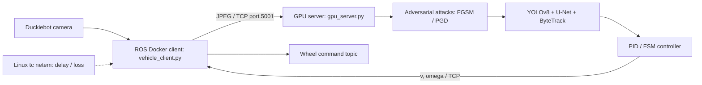

# Adversarial Robustness Analysis of Cloud-Assisted Autonomous Driving Systems

Code for the IEEE paper:

> **Adversarial Robustness Analysis of Cloud-Assisted Autonomous Driving Systems**  
> Maher Al Islam and Amr S. El-Wakeel  
> *2026 International Conference on Smart Mobility (SM)*, IEEE, 2026.  
> DOI: **[10.1109/SM69703.2026.11614113](https://doi.org/10.1109/SM69703.2026.11614113)**

## Overview

This project studies adversarial vulnerabilities in **cloud-assisted autonomous driving** using a physical Duckietown testbed. Each Duckiebot streams camera frames over TCP to a GPU workstation. The workstation performs object detection (YOLOv8n), lane segmentation (U-Net), tracking (ByteTrack), and lane/traffic-rule control (PID/FSM), then sends linear velocity `v` and angular velocity `omega` to the robot.

The evaluated threats are **white-box adversarial perturbations** (FGSM and PGD) applied to the cloud-side visual input, and **network impairments** (delay and packet loss) applied to the vehicle–cloud link.

## System architecture



The **Duckiebot client runs in Docker using `dts devel build` and `dts devel run`**. The **GPU inference server runs on the workstation** as a separate Python process. The figure shows the logical attack locations; impairment is configured on the network interface selected by the experimenter.

## Repository structure

```text
Adversarial-Robustness-Analysis-of-Cloud-Assisted-Autonomous-Driving-Systems/
├── README.md
├── CITATION.cff
├── Dockerfile                      # Duckietown image definition
├── launchers/default.sh            # Duckietown container startup
├── packages/my_package/            # ROS client package
│   └── src/vehicle_client.py       # Camera frames -> TCP; control -> ROS
├── gpu_server.py                   # GPU-side TCP server and experiment logging
├── perception_control.py           # YOLOv8, U-Net, ByteTrack, PID/FSM
├── class_labels.py                 # Shared detection class names
├── visualization.py                # Debug overlays
├── segmentation/
│   └── unet_model.py               # U-Net architecture
├── adversarial_attacks.py           # Online FGSM and PGD attacks
├── configure_attacks.py            # Enable/disable runtime attacks
├── evaluate_adversarial_detection.py # Offline FGSM/PGD evaluation
├── plot_adversarial_metrics.py      # Precision/recall evaluation plots
├── plot_yolo_validation.py         # Optional YOLO validation plots
├── run_network_impairment.sh       # Network delay/loss experiments
├── weight/                         # Provided model checkpoints
├── results/figure4_published_values.csv
└── requirements-server.txt
```

## Main components

| Component | Script | Role |
| --- | --- | --- |
| Duckiebot client | `packages/my_package/src/vehicle_client.py` | ROS camera subscriber, TCP transport, velocity command publisher |
| Cloud GPU server | `gpu_server.py` | Receives frames, calls inference and control, returns `v`/`omega`, logs selected telemetry |
| Perception and control | `perception_control.py` | YOLOv8, U-Net, ByteTrack, lane following and intersection logic |
| Visual attacks | `adversarial_attacks.py` | Online white-box FGSM/PGD |
| Attack control | `configure_attacks.py` | Controls live attack settings via a shared JSON file |
| Offline evaluation | `evaluate_adversarial_detection.py` | Generate adversarial test examples and detection records |
| Results plots | `plot_adversarial_metrics.py` | Analyze offline attack metrics |
| Network impairment | `run_network_impairment.sh` | Linux `tc netem` scenarios |

## Installation and execution

### 1. GPU workstation

```bash
git clone https://github.com/ICPS-LAB-WVU/Adversarial-Robustness-Analysis-of-Cloud-Assisted-Autonomous-Driving-Systems.git
cd Adversarial-Robustness-Analysis-of-Cloud-Assisted-Autonomous-Driving-Systems

# Install a compatible CUDA-enabled PyTorch environment separately.
python3 -m pip install -r requirements-server.txt
```

The cloud pipeline imports `yolox.tracker.byte_tracker` from [ByteTrack](https://github.com/ifzhang/ByteTrack). Install a compatible ByteTrack/YOLOX checkout and include it in `PYTHONPATH`:

```bash
git clone https://github.com/ifzhang/ByteTrack.git
export PYTHONPATH="$PWD/ByteTrack:$PYTHONPATH"
```

A compatible PyTorch, Ultralytics, YOLOX, and tracker dependency environment is necessary. The `requirements-server.txt` file is a starting list, not a frozen, verified environment.

Checkpoints included in `weight/`:

- `weight/yolo.pt` — supplied YOLO model
- `weight/segment_model_old.pth` — supplied lane segmentation model

These checkpoint files were recovered from the provided project archive; their exact provenance relative to every published experiment is not independently verified. You may override them with `YOLO_WEIGHTS` and `SEG_WEIGHTS`.

Start the GPU server:

```bash
export YOLO_WEIGHTS=weight/yolo.pt
export SEG_WEIGHTS=weight/segment_model_old.pth
export GPU_SERVER_PORT=5001
export SHOW_GUI=0
export SAVE_VIDEO=0
python3 gpu_server.py
```

Ensure that the workstation is reachable from the Duckiebot on TCP port `5001`.

### 2. Duckiebot Docker deployment (`dts devel`)

Run these commands on the computer with the Duckietown CLI and repository checkout:

```bash
# Replace ruks007 with the actual robot hostname
dts devel build -H ruks007 -f

export GPU_SERVER_IP="YOUR_GPU_WORKSTATION_IP"
export GPU_SERVER_PORT=5001
export GPU_FRAME_RATE=15

dts devel run -H ruks007 -f -- \
  -e GPU_SERVER_IP \
  -e GPU_SERVER_PORT \
  -e GPU_FRAME_RATE
```

`launchers/default.sh` invokes `rosrun my_package vehicle_client.py` **inside the Duckiebot container**. The client subscribes to the compressed camera stream and publishes `Twist2DStamped` commands to the vehicle's command-switch topic.

### Communication protocol

```text
Duckiebot -> GPU server : img_size,vehicle,frame_id,t_gen\n + JPEG data
GPU server -> Duckiebot : vehicle,frame_id,v,omega,t_server,aoi_server\n
```

The vehicle client also sends a timing-statistics line after receiving commands. That optional line is not fully integrated into the server's CSV telemetry handling.

## Adversarial AI evaluation

### Online FGSM/PGD

While the GPU server is active, use a second terminal **on the same workstation**:

```bash
# Projected Gradient Descent
python3 configure_attacks.py --on --mode wb_pgd --eps 0.04 --alpha 0.01 --iters 10

# Fast Gradient Sign Method
python3 configure_attacks.py --on --mode wb_fgsm --eps 0.02

# Return to clean perception
python3 configure_attacks.py --off
```

The live attack code can construct pseudo-labels from clean detections; this is distinct from evaluation with labeled test images.

### Offline FGSM/PGD

Prepare YOLO-format image and label pairs under `dataset/images/` and `dataset/labels/`. Then run:

```bash
python3 evaluate_adversarial_detection.py \
  --images dataset/images --labels dataset/labels \
  --weights weight/yolo.pt --out offline_attacks \
  --eps 0.01 0.02 0.04 --pgd-alpha 0.01 --pgd-iters 10 \
  --loss-mode full

python3 plot_adversarial_metrics.py --root . --bar-conf 0.25 --bar-iou 0.5
```

The explicit epsilon values and PGD settings reflect those stated in the paper. The original script defaults differed; it is not established that every published plot was generated with this exact command.

## Network-impairment experiments

The network experiment script uses Linux `tc netem`, requires `sudo`, and changes network-interface queuing. Run only on an authorized isolated test network; check which interface carries Duckiebot traffic before executing it.

```bash
# On the GPU workstation; replace interface name with the correct one
DEVICE=enp0s31f6 ./run_network_impairment.sh delay 150 90
DEVICE=enp0s31f6 ./run_network_impairment.sh loss 2 90
```

This script launches `gpu_server.py` for each scenario; do **not** run a second `gpu_server.py` instance on the same port simultaneously.

## Paper results

| Condition | Detection precision | Detection recall |
| --- | ---: | ---: |
| Clean | 0.73 | 0.68 |
| FGSM (`ε=0.04`) | 0.38 | 0.46 |
| PGD (`ε=0.04`) | 0.22 | 0.15 |

The paper also reports closed-loop degradation under network delay (100–250 ms) and packet loss (0.5–5%). `results/figure4_published_values.csv` contains **reported figure values**, not the original full prediction logs.

## Reproducibility and scope

The source code has been renamed and statically checked for import/launcher consistency, but the entire Duckietown-to-GPU closed loop has not been executed for this release. The original dataset split, complete experiment logs, and exact checkpoint provenance are not bundled. Researchers should confirm dependencies, thresholds, and calibration before operating robots. Start with the vehicle safely immobilized.

## Citation

```bibtex
@inproceedings{alislam2026adversarial,
  author    = {Al Islam, Maher and El-Wakeel, Amr S.},
  title     = {Adversarial Robustness Analysis of Cloud-Assisted Autonomous Driving Systems},
  booktitle = {2026 International Conference on Smart Mobility (SM)},
  year      = {2026},
  publisher = {IEEE},
  doi       = {10.1109/SM69703.2026.11614113}
}
```

Paper: https://doi.org/10.1109/SM69703.2026.11614113

## Authors and acknowledgment

**Maher Al Islam** and **Amr S. El-Wakeel**  
Lane Department of Computer Science and Electrical Engineering, West Virginia University, USA.

This research was partially supported by DARPA AI-CRAFT AWD16069.
